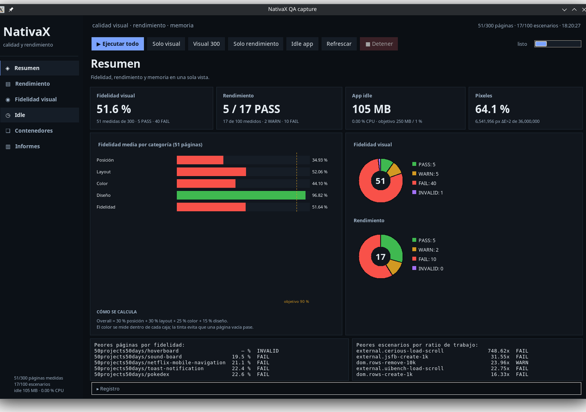
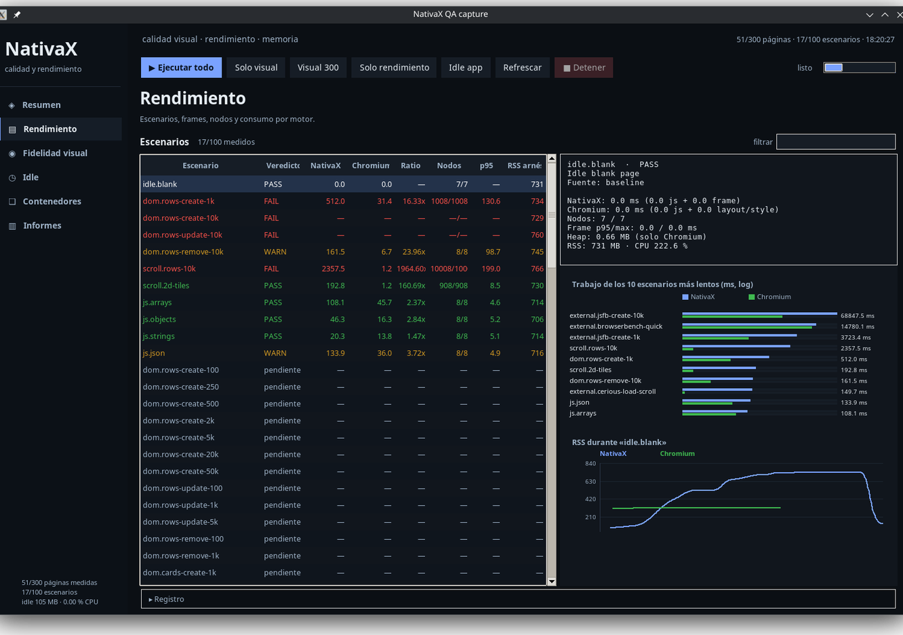

# Rendimiento y respuesta de NativaX

Este apartado mide si NativaX **rinde y responde como un navegador** sin usar
WebView, Chromium embebido, CEF ni Electron. Chromium es solo el instrumento de
referencia; los dos motores ejecutan la misma página y el mismo JavaScript.

Es independiente del juicio visual (`tools/visual`): allí se pregunta *¿se ve
igual?*; aquí, *¿se mantiene fluido, responde y cabe en memoria?*

## Comandos

```bash
# Escenarios internos + benchmarks externos vendorizados
dart run tools/perf/bin/perf.dart run --out .perf/latest

# Añade la medición real de la app Flutter en reposo (abre su ventana ~8 s)
dart run tools/perf/bin/perf.dart run --app-idle --out .perf/latest

# Panel Tkinter con tabla, gráficas, RSS/CPU y botones de ejecución
python3 tools/perf/gui/perf_gui.py
```

El contrato completo (escenarios, fórmulas, salidas y límites) está en
[`tools/perf/README.md`](../tools/perf/README.md).

## Qué se mide

| Métrica | Chromium | NativaX |
|---|---|---|
| Tiempo del escenario | `performance.now()` en la página | tiempo de evaluación JS |
| Trabajo de frame | `LayoutDuration + RecalcStyleDuration` (CDP) | coste de `tester.pump()` offscreen |
| Nodos | `getElementsByTagName('*').length` | idéntico |
| Heap | `JSHeapUsedSize` | no expuesto |
| RSS / CPU | PSS/CPU de `/proc` para todo el árbol | idéntico |
| GPU | `gpu_busy_percent` si el kernel lo expone | idéntico |
| Puntuación propia de la página | `window.__lastRun` | idéntica |

`Trabajo = escenario + render`. El frame de Chromium es layout/style del hilo
principal; el de NativaX es un pump offscreen. Están relacionados, pero no son
el mismo reloj: el cociente es una señal de regresión, no FPS.

## Objetivos

- Frame p95 de NativaX en scroll ≤ **16,7 ms**; ningún frame > **100 ms**.
- Trabajo NativaX / Chromium ≤ **3×** (no se aplica a scroll: el compositor de
  Chromium puede tardar menos de 1 ms y el cociente no tendría sentido).
- Nodos dentro del **5 %** de Chromium.
- App de escritorio en reposo: RSS ≤ **250 MB** y CPU ≤ **1 %**.
- `PASS` si cumple todo, `WARN` con un fallo, `FAIL` con dos o más. Un frame de
  más de 100 ms es `FAIL` directo.
- Un fallo del motor o del arnés es `FAIL`; nunca se convierte en `PASS`.

## Benchmarks integrados

- **js-framework-benchmark** (Apache-2.0): implementación oficial vanilla
  keyed, vendorizada. Crear 1.000/10.000 filas, limpiar.
- **Browser-Bench** (MIT): ejecución Quick de la propia página y lectura de su
  puntuación.
- **Cerious-Scroll** (MIT): página real de benchmark, carga y scroll.
- **uibench** (sin licencia): se descarga en `.perf/suites/`, no se
  redistribuye.
- **million-rows-benchmark** (sin licencia): requiere build npm; se documenta
  como opcional y no se ejecuta por defecto.
- **PassMark 2D HTML Scroll**: página propietaria no redistribuible;
  `scroll.2d-tiles` reproduce el mismo trabajo 2D y lo cita.
- Escenarios internos de filas, scroll 1D/2D y cargas JS modelados sobre esos
  benchmarks.

## App en reposo (250 MB / 0 % CPU)

El objetivo es del **proceso de la app**, no del arnés de test. La app Linux de
`examples/web-challenge` acepta `NATIVAX_PERF_PAGE` y carga una página blanca
desde disco. `idle-app` compila el bundle release si hace falta, la abre, espera
3 s de calentamiento + 5 s de reposo, muestrea PSS/CPU y la cierra. El resultado
se escribe en `.perf/app-idle.json` y aparece en el informe y en el panel.

La GPU se reporta si el kernel expone `gpu_busy_percent`; si no, se dice
`not exposed` en vez de inventar un número.

## Panel Tkinter

`tools/perf/gui/perf_gui.py` abre una ventana con barra lateral de navegación:

- **Resumen**: fidelidad media, donuts de veredictos, píxeles/tinta, peores
  páginas y escenarios.
- **Rendimiento**: tabla completa, detalle por operación, barras de trabajo en
  escala logarítmica, RSS en el tiempo y motivos.
- **Fidelidad visual**: 300 páginas (51 medidas y el resto pendientes), barras
  por categoría, píxeles/color, peores causas y miniaturas de
  Chromium/NativaX/diferencia.
- **Conformidad**: Test262, html5lib, URL, WPT DOM/CSS/tree con botones para
  ejecutar cada suite y tabla PASS/FAIL/SKIP/ERROR. Se refresca con los
  resultados de `.conformance/results`.
- **Vídeo**: 25 perfiles 360p–2160p, estado del contrato y aviso explícito de
  que **no hay reproducción real**; botón para relanzar los tests de contrato.
- **Videojuegos**: 25 perfiles Canvas 2D + 25 3D, tabla de resultados y botón
  para ejecutar cada lote. No es el game-player Three.js completo.
- **Vídeo**: 25 perfiles 360p–2160p, estado del contrato y aviso explícito de
  que **no hay reproducción real**; botón para relanzar los tests de contrato.
- **Juegos**: 25 perfiles Canvas 2D por resolución/partículas, tabla de
  resultados y botón para ejecutar el lote de juegos. No es el game-player
  Three.js completo.
- **Idle**: RSS/CPU reales frente a 250 MB / 1 % y muestras.
- **Informes**: un informe independiente por área — **Rendimiento**
  (`.perf/live/report-perf.md`), **Visual** (`report-visual.md`), **Juegos**
  (`report-games.md`), **Conformidad**, **Auditoría JSON** y **Recomendaciones**;
  ninguno mezcla datos de otra área. Los generados por el panel se recalculan desde
  `results.json`, `app-idle.json` y la matriz cada vez que cambian los datos;
  se muestra como captura del HTML real (misma tipografía, tablas y colores)
  y con scroll. Durante una ejecución se muestra el texto actualizado sin
  lanzar Chromium; al terminar se genera la captura. Los informes
  **Histórico …** quedan como snapshots manuales.
- **Historial**: guarda cada corrida como JSON detallado en `.visual/history`
  y `.perf/history`, compara la última con la anterior y muestra los casos que
  mejoraron o empeoraron en posición, layout, color, diseño, ΔE, ratio, p95
  y RSS.
- **Acciones por fila**: clic derecho en un escenario o página (o el botón
  **Acciones ▾**) abre un menú para **ver detalles** o **ejecutar solo ese
  test/página**. Al terminar, el resultado se fusiona en la tabla sin borrar
  los demás y se abre el detalle.
- Botones para ejecutar todo, solo visual, solo rendimiento, idle real,
  refrescar o detener; registro en la propia ventana.





## Catálogo de escenarios

El registro contiene **245 escenarios**: 239 internos y 6 benchmarks externos
resueltos (Browser-Bench, js-framework-benchmark, Cerious-Scroll y uibench).
Cubren DOM, scroll, JavaScript, layout, formularios, animación y canvas. El
catálogo se regenera con:

```bash
dart run tools/perf/bin/perf.dart list --json > tools/perf/scenarios.json
```

El panel muestra los **245** desde el primer arranque; los no ejecutados
aparecen como `pendiente`. Si `scenarios.dart` o `externals.dart` cambian, el
panel regenera `scenarios.json` en segundo plano; el catálogo visual hace lo
mismo cuando cambia `fixtures.dart`. La tabla se actualiza automáticamente cada segundo
cuando `results.json`, `app-idle.json`, la matriz Docker o el catálogo cambian,
también si la ejecución se lanzó fuera del panel. Cada escenario escribe un
snapshot atómico de `results.json`, así que los resultados aparecen página a
página sin esperar al final.

## Informe con recomendaciones

`python3 tools/recommend.py --out progress/reports/recommendations-latest.md`
genera un informe determinista con prioridades **P0/P1/P2**, evidencia medida,
acción, criterio de aceptación y comando. El informe incluye detalle por
escenario (ratio, p95/max, nodos, RSS y siguiente acción), detalle visual con
causas raíz por página, tablas de juegos y vídeo, cobertura pendiente por suite
y procedencia de los datos. No es una caja negra ni inventa
porcentajes: si falta cobertura lo declara y baja la confianza. `quality_report.sh`
lo regenera después de las suites, y el panel lo muestra en **Informes →
Recomendaciones**, separado de los informes de cada área.

## Vídeo y juegos por calidad

- **Vídeo:** 25 tests de contrato en `packages/nativa_render/test/video_quality_test.dart`
  cubren 360p, 480p, 720p, 1080p, 1440p, 2160p, retrato, cuadrado, ultrawide,
  atributos y tamaños CSS. **NativaX todavía no decodifica vídeo**: el test fija
  el placeholder `▶ video`, las dimensiones y el contrato
  `MEDIA_ERR_SRC_NOT_SUPPORTED`. No es una prueba de reproducción real.
- **Juegos:** 25 escenarios Canvas 2D en `tools/perf` con resoluciones
  640x360, 854x480, 1280x720, 1920x1080 y 2560x1440, y 100–5.000 partículas.
  Miden un frame de juego; el `examples/game-player` Three.js completo no se
  ejecuta en esta matriz.

## Línea base medida (2026-10-24)

App Linux en reposo, página blanca: **105,0 MB de RSS y 0,00 % de CPU**
(objetivo 250 MB / 1 %). GPU no expuesta por el kernel en esta máquina.

Última pasada medida: **17 escenarios** (de los 245 definidos), con
**4–5 PASS, 2–4 WARN, 9–10 FAIL, 0 INVALID** (última: 5/2/10).

- JS puro (`arrays`, `objects`, `strings`, `json`): PASS, 0,4×–2,4×.
- Crear 1.000 filas: 312–356 ms vs 70–76 ms (4,4×–4,7×, WARN).
- Crear 10.000 filas: 6,6–8,2 s vs ~245 ms, o timeout del presupuesto JS (FAIL).
- Actualizar/limpiar 10.000 filas: presupuesto de QuickJS agotado (FAIL).
- Scroll de 10.000 filas: p95 108–206 ms y frame máximo 128–230 ms (FAIL).
- Scroll 2D de 900 teselas: p95 6,8–8,4 ms, nodos idénticos (PASS).
- js-framework-benchmark vanilla 1.000 filas: 13,6×–21,1× y frame de ~170–190 ms (FAIL).
- Browser-Bench Quick: Chromium 31.176; NativaX no completa (FAIL).
- Cerious-Scroll real: 416 vs 721 nodos; uibench 13 vs 153 (FAIL).

Detalle por escenario y comandos:
[`progress/reports/perf-latest.md`](../progress/reports/perf-latest.md).

## Aislamiento con Docker

```bash
tools/perf/container/matrix.sh
tools/perf/container/run.sh --cpus 1 --memory 1g --name low --only 'js.arrays'
```

Chromium y `flutter test` corren en el mismo contenedor con `--cpus`,
`--memory` y `--network none`. El panel permite elegir CPU (0,25–4), RAM
(512 MB–4 GB), nombre y lista de tests antes de lanzar un contenedor a medida. La imagen se construye una vez y monta Flutter y
el repo en sus rutas reales. Resultados en `.perf/container/` y sección
**Contenedores** del panel. Son cuotas cgroup, no frecuencia real; no hay
estresores concurrentes ni soak tests. El RSS de esa tabla es el **PSS del
arnés** `flutter test` (694–720 MB), no la app; el idle real de la app es
**105 MB / 0 % CPU**. En el panel se muestra como «RSS arnés / RAM del
contenedor».

## Compuerta sin UI (IA/CI)

```bash
python3 tools/quality_gate.py --run      # visual + rendimiento + compatibilidad
python3 tools/quality_gate.py            # reutiliza artefactos existentes
python3 tools/quality_gate.py --json     # JSON limpio
```

Códigos de salida: `0` = igual/mejor o base creada, `2` = regresión,
`3` = faltan mediciones. Escribe `progress/reports/quality-gate-latest.md` y
`.json`.

## Vista previa del informe

```bash
tools/preview_report.sh                 # informe consolidado
tools/preview_report.sh progress/reports/perf-latest.md
```

Renderiza Markdown a HTML y lo abre. También está disponible dentro del panel
Tkinter en la sección **Informes**.

## Límites declarados

- Los frames offscreen son CPU (build/layout/paint), no rasterización GPU ni
  refresco de pantalla.
- La red está bloqueada en ambos motores.
- El heap solo lo reporta Chromium.
- Crear 10.000 filas en una sola llamada JS agota el presupuesto de ejecución
  de QuickJS y se reporta como fallo real del runtime.
- Los números de una sola pasada tienen varianza; el cociente sirve para
  detectar regresiones, no como medida absoluta de FPS.
- No es una tasa de compatibilidad.
